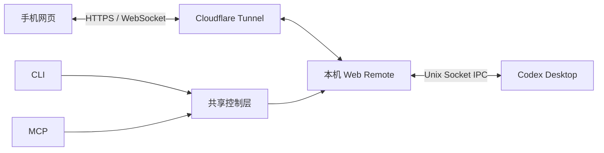

# Codex Web Remote

用手机扫码连接本机 Codex Desktop：查看工作区和会话、发送或补充指令、停止当前任务，以及选择模型和权限模式。提供 **CLI 和 MCP** 两种调用接口，底层共用同一个控制服务。

这是独立项目，通过 Desktop 的内部 IPC 协议集成；目前在 **macOS** 验证。Desktop 更新、IPC 协议或本地数据库结构变化可能需要适配，尚未验证 Windows/Linux。

## 快速安装

需要 Node.js **24+**、Python 3、已登录并运行的 Codex Desktop，以及 `codex` CLI。公网模式还需要 `cloudflared`，局域网模式不需要。

```sh
# macOS 公网隧道依赖
brew install cloudflared

git clone https://github.com/bicheng01/codex-web-remote.git
cd codex-web-remote
npm ci
npm run build
npm link

codex-remote --help
```

`npm link` 注册 `codex-remote` 和 `codex-remote-mcp`。如果 npm 全局目录不可写，使用自己的 Node 安装目录，或直接执行 `node plugin/cli.mjs`。本仓库目前发布在 GitHub，尚未发布到 npm registry。

## CLI 使用

```sh
# 启动后扫码，手机上选择工作区和会话
codex-remote start --mode public

# 此后复用现有服务
codex-remote start
codex-remote status
codex-remote qr
codex-remote stop

# 保存 PNG 或供脚本/Agent 读取
codex-remote qr --output ./pairing.png
codex-remote status --json
```

`start` 和 `qr` 在终端直接打印可扫描二维码。`start` 复用现有服务，`qr` 刷新配对码，`stop` 撤销手机连接并停止此安装拥有的后台服务，不中断电脑上的任务。CLI 无需模型参与。公网首次启动会等待隧道注册、预热会话列表，并检查公网页面及 JS/CSS 资源后再出码；终端显示各阶段进度（`--json` 保持纯 JSON）。`stop` 等待后台退出后返回，避免紧接着 `start` 发生端口冲突。检测只代表电脑侧可达，手机网络仍可能受运营商或浏览器影响。

如果仅同一 Wi-Fi 使用：

```sh
codex-remote start --mode lan
```

切换网络模式或端口前，先 `stop` 再 `start`。每个运行目录管理一个服务。`--runtime <dir>` 或 `REMOTE_RUNTIME_DIR` 可指定另一目录；不要把不同安装指向同一个已有服务却误以为会自动更换服务所有者。

## MCP 接入

### 独立 MCP（不安装插件也可使用）

在克隆目录执行：

```sh
codex mcp add web_remote -- node "$PWD/plugin/mcp.mjs"
```

如果 Desktop 从 Finder 启动后找不到 Node，用实际 Node 绝对路径注册：

```sh
codex mcp add web_remote -- "$(command -v node)" "$PWD/plugin/mcp.mjs"
```

注册后重新加载客户端或开启新聊天。其他支持 stdio MCP 的 Agent 可以配置：

```json
{
  "mcpServers": {
    "web_remote": {
      "command": "node",
      "args": ["/absolute/path/to/codex-web-remote/plugin/mcp.mjs"]
    }
  }
}
```

MCP 工具：

| 工具 | 功能 |
| --- | --- |
| `start_remote` | 启动或复用服务，返回二维码图片与 PNG 路径 |
| `remote_status` | 读取服务和桌面连接状态 |
| `refresh_qr` | 一次调用刷新并返回二维码 |
| `stop_remote` | 撤销手机连接，停止本插件拥有的服务 |

`start_remote` 无需会话 ID，可指定 `mode: public` 或 `lan`、`port`。运行中的服务会被复用。MCP 返回 text 元数据与 image 内容，若客户端不直接渲染 image，Agent 可用返回的 `imagePath` 在聊天内显示图片。协议的 stdout 只输出 MCP 消息。

### Codex 插件（MCP）

先完成上面的 `npm ci` 和 `npm link`，再在克隆目录执行：

```sh
codex plugin marketplace add "$PWD"
codex plugin add codex-web-remote@codex-web-remote
```

插件的 `.mcp.json` 调用全局命令 `codex-remote-mcp`，因此客户端必须能在 PATH 找到它。若图形界面的 PATH 不包含 npm 全局目录，使用上一节的绝对路径 MCP 注册方式即可。
选择一种 MCP 注册方式即可，避免插件和独立 MCP 同时注册而出现两组重复工具。客户端可能需要重启或新聊天才能发现新工具。安装插件本身不会启动公网服务。

完整步骤和故障处理见 [安装文档](docs/INSTALL.md)，工作原理见 [架构文档](docs/ARCHITECTURE.md)。

## 手机端功能

- 工作区与聊天列表；已加载聊天可控制，其他聊天回退为只读历史。
- 通过 WebSocket 接收增量状态；断线后重连，并以 HTTP 获取状态作为回退。
- 空闲时发起新一轮；运行中发送补充要求；停止操作校验当前 turn ID。
- 模型选项来自 Codex CLI 可用模型列表，设置写入 Desktop 聊天并用于下一轮。
- 请求批准、帮我批准、完全访问权限三种模式；实际审批仍受 Desktop 和组织策略约束。
- Markdown 通过 DOMPurify 清理；代码块、复制、主题切换、执行记录折叠。

## 连接与数据



公网使用 Cloudflare Quick Tunnel 的临时 `trycloudflare.com` 地址，重建隧道后地址会变化。配对码约 5 分钟有效且单次使用；手机会话凭证约 8 小时有效，停止遥控会撤销。工作区列表会暴露本机项目路径和聊天标题，仅向配对后的客户端提供。

默认状态目录是 `${CODEX_HOME:-~/.codex}/web-remote`，CLI 和 MCP 共用。目录权限 0700，凭证、日志、二维码文件权限 0600。**日志可能包含管理地址；二维码和手机会话凭证也允许访问当前设备，不要提交或公开分享这些文件。** 本项目不要求复制 OpenAI API Key，但公网模式下网页和控制流量会经过 Cloudflare。

电脑、Desktop、桥接服务和隧道需要持续运行。网络延迟、休眠和临时隧道故障会影响连通性；项目不承诺手机运营商网络始终可达。

## 开发与测试

```sh
npm ci
npm run build
npm test

# 可选：真实 Desktop 集成测试，不发送消息或中断任务
REMOTE_TEST_THREAD=<thread-id> npm test
```

普通测试使用夹具，未设置 `REMOTE_TEST_THREAD` 时跳过真实会话控制测试；无会话 ID 的启动和 MCP 生命周期测试始终运行。集成测试使用本机端口 43128/43129，请确保它们空闲。前端发布资源带内容哈希并支持 gzip/Brotli，认证与 API 响应不缓存。

## 许可

Apache-2.0。界面部分参考和改编自 [ZCode](https://github.com/zai-org/ZCode)，并使用 Marked、DOMPurify、Lucide 等第三方组件。原始许可、修改说明及归属见 [THIRD-PARTY.md](THIRD-PARTY.md) 与根目录 `NOTICE` / `LICENSE`。
